  
  
  
  

## Hi, I'm Gabriel 👋

I'm a **physicist and licensed teacher who builds AI and automation systems**. I like problems where physics, math and code meet: training GANs on satellite radar images, letting LLM agents run a factory cell, writing PLC state machines and deriving robot dynamics from first principles.

- 🎓 **M.Sc. AI & Automation**, University West: top grade (A) in Multi-Agent Systems and in Mechatronics for Automation
- 🔬 **B.Sc. Physics** · **Master of Education**, Linköping University
- 🧑‍🏫 Licensed upper-secondary teacher in physics, mathematics and AI, with six years in the classroom
- 🔭 Currently exploring agentic AI for manufacturing, LLMs on edge devices and physics-informed neural networks
- 🌍 Swedish · English · Arabic · Aramaic

## 🧠 AI & Machine Learning

  <a href="https://github.com/gabrieldanho9988-sys/SAR-Super-Resolution-Using-AI">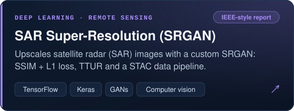</a>
  <a href="https://github.com/gabrieldanho9988-sys/Machine_Vision_Group_Project">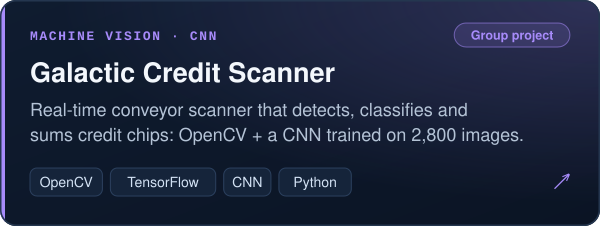</a>
  <a href="https://github.com/gabrieldanho9988-sys/MUA600-Multi-Agent-Manufacturing">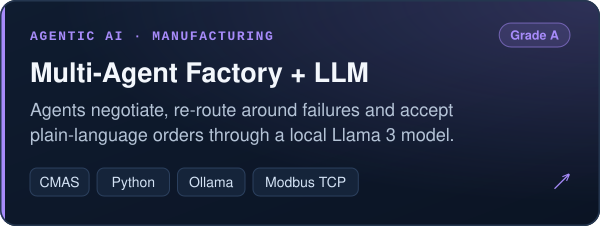</a>
  <a href="https://github.com/gabrieldanho9988-sys/Social_Anxiety_ML_Project">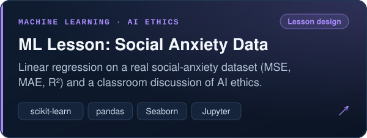</a>

## ⚙️ Automation & Control

  <a href="https://github.com/gabrieldanho9988-sys/agv-operator-hmi">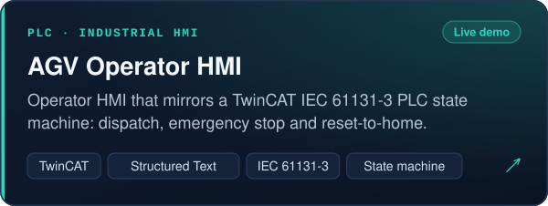</a>
  <a href="https://github.com/gabrieldanho9988-sys/tbot-modelling-and-control">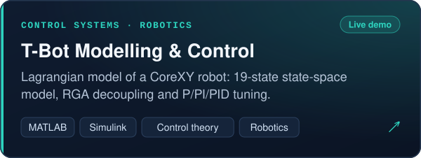</a>
  <a href="https://github.com/gabrieldanho9988-sys/rtd-daq-simulink-arduino">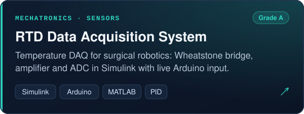</a>
  <a href="https://github.com/gabrieldanho9988-sys/Simulation_Project_Python">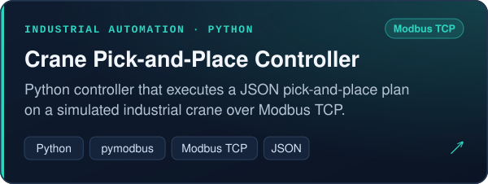</a>

▶️ **Try the live demos:** [AGV Operator HMI](https://gabrieldanho9988-sys.github.io/agv-operator-hmi/) · [T-Bot “Work Done by Forces”](https://gabrieldanho9988-sys.github.io/tbot-modelling-and-control/)

## 🎓 AI in Education

  <a href="https://github.com/gabrieldanho9988-sys/Physics-Labs-Upper-Secondary">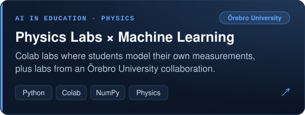</a>
  <a href="https://github.com/gabrieldanho9988-sys/Gy25-Physics-Math-AI-Labs">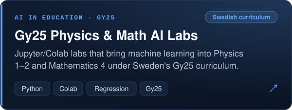</a>

## 🛠️ Toolbox

**AI & data** 

**Automation & control** 

**Tools** 

📚 Also on my profile: forks I study and build on: [handson-ml3](https://github.com/gabrieldanho9988-sys/handson-ml3) (machine learning) · [CMAS](https://github.com/gabrieldanho9988-sys/CMAS) (multi-agent framework) · [inverse-DR](https://github.com/gabrieldanho9988-sys/inverse-DR) (physics-informed neural networks)

## 📫 Let's connect

I'm open to **AI engineering** and **automation engineering** roles, in Sweden and abroad.
The fastest way to reach me is [LinkedIn](https://www.linkedin.com/in/gabriel-danho-2a1a9112a) or [email](mailto:gabriel.danho@hotmail.com).
